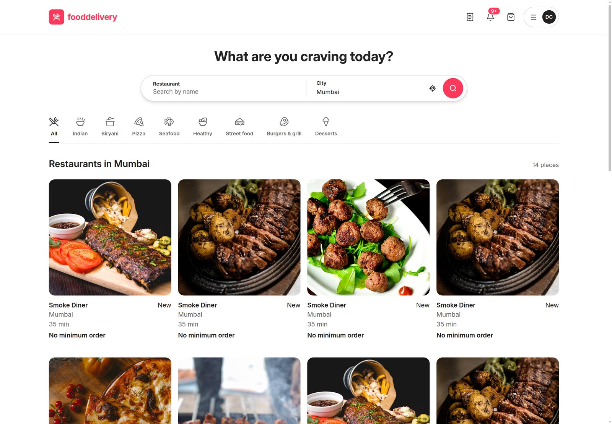
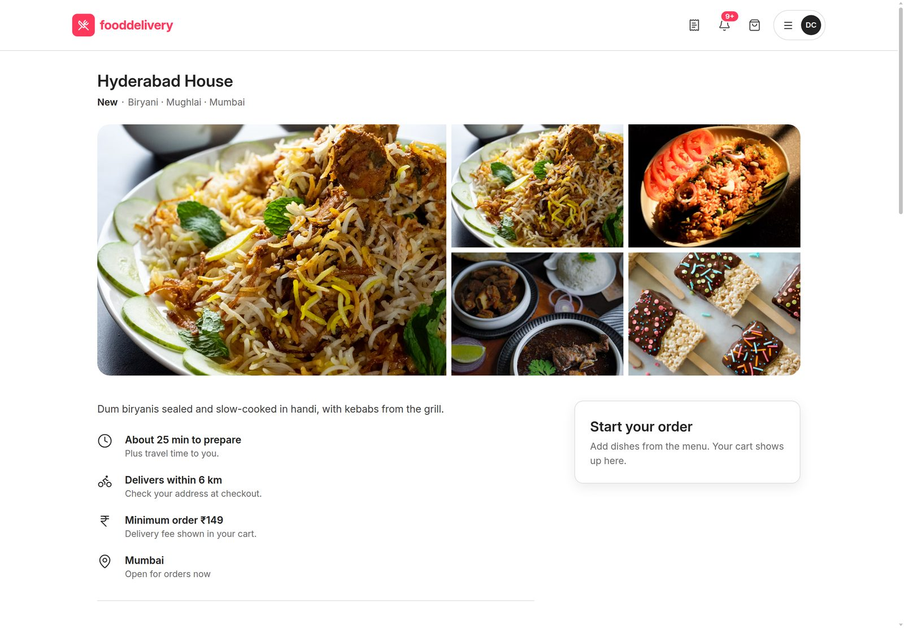
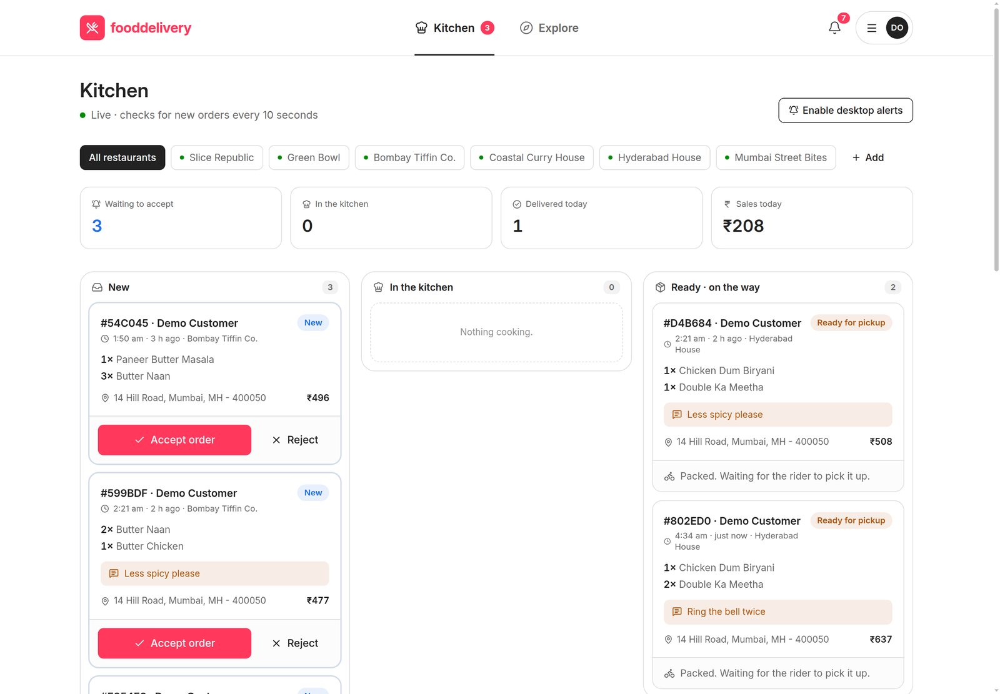
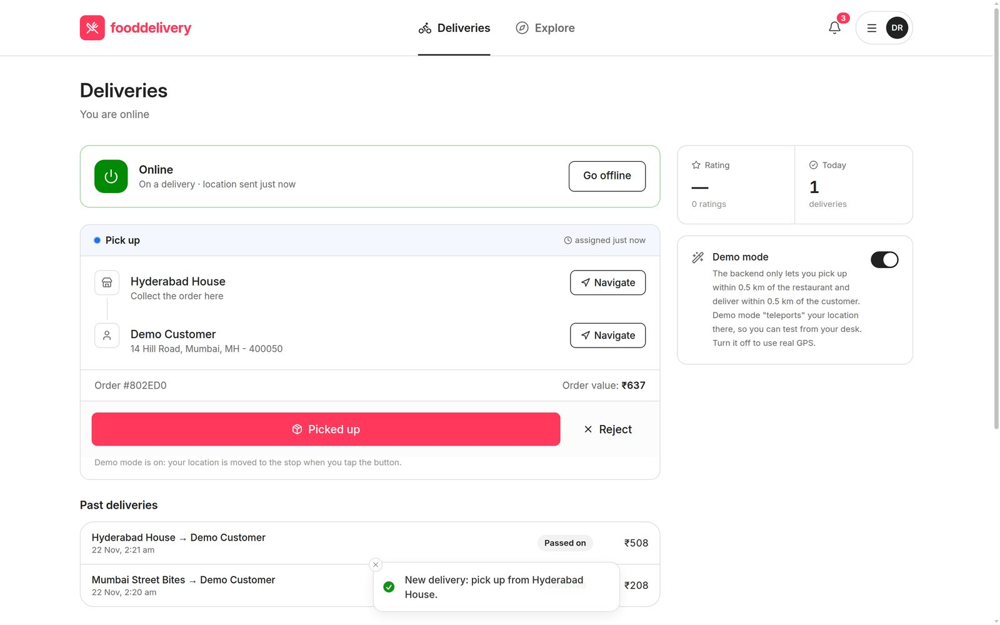
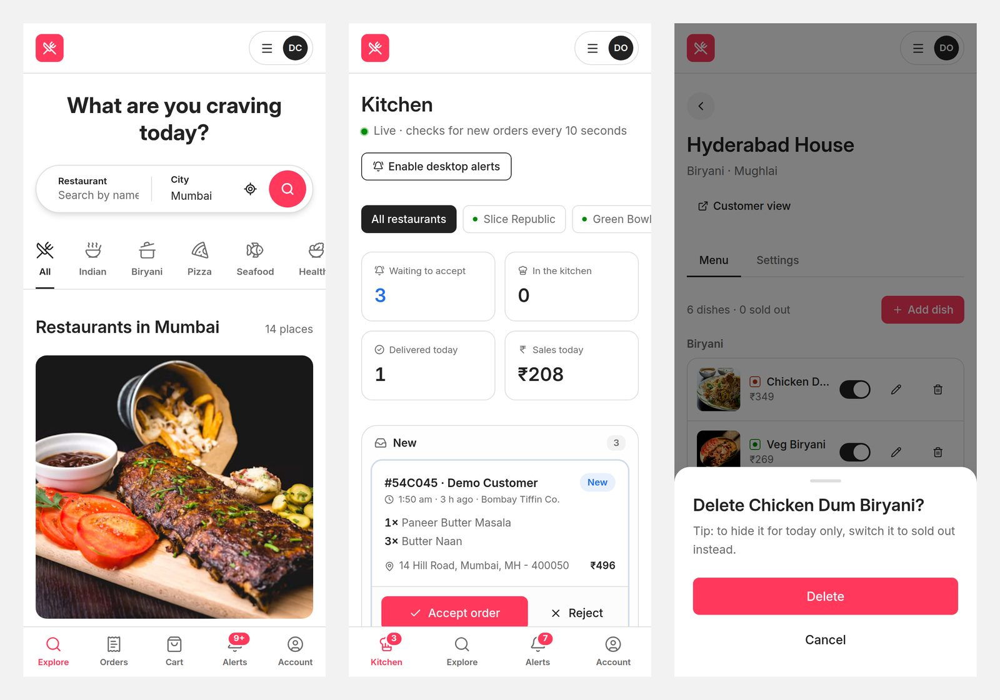
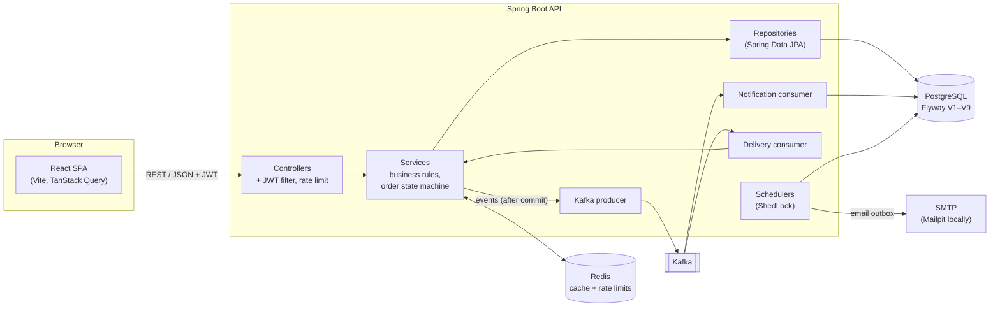
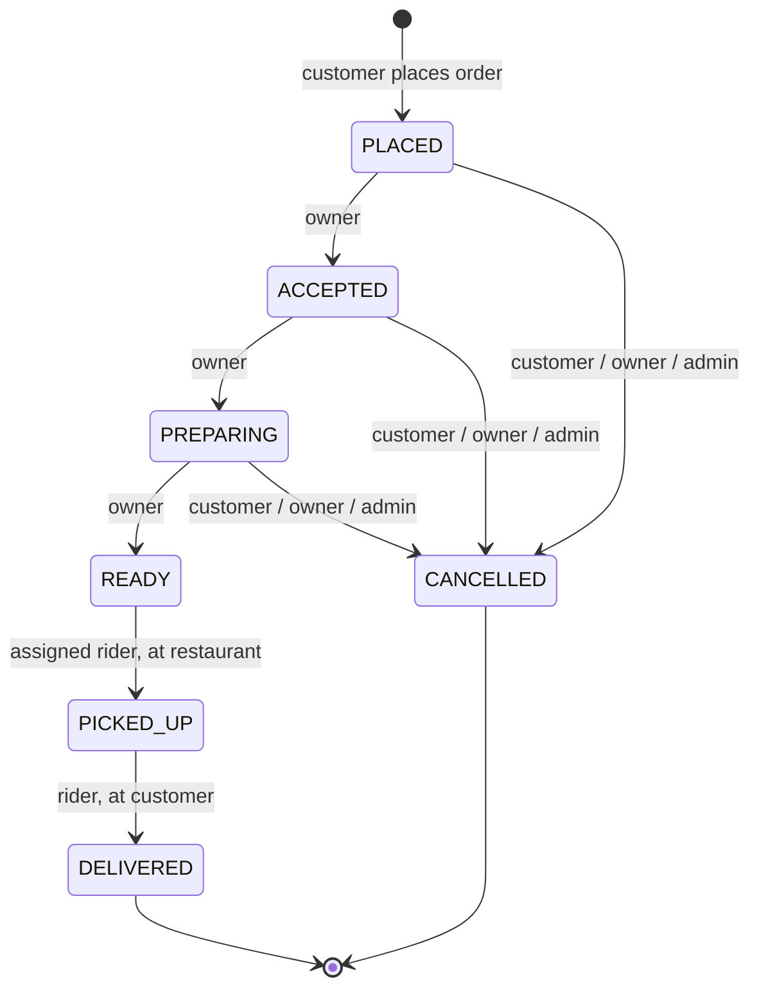

# Biteline

**A full-stack food delivery platform**

[](https://github.com/amit6537/biteline/actions/workflows/ci.yml)

A Swiggy/Zomato-style food delivery system: a **Spring Boot backend** that coordinates
customers, restaurants, payments and delivery riders through an order state machine and
Kafka events, plus a **React frontend** with separate experiences for customers,
restaurant owners, delivery partners and admins.

The interesting part isn't restaurant CRUD. It's the workflow between five parties:

**Customer → Restaurant → Order → Payment → Delivery partner**

…kept correct under concurrency (two riders, one order), partial failure (mail server
down, Redis down) and retries (a payment request sent twice).



| Restaurant page | Kitchen dashboard |
|---|---|
|  |  |

| Rider app | On a phone |
|---|---|
|  |  |

---

## Contents

- [What it does](#what-it-does)
- [Architecture](#architecture)
- [Engineering highlights](#engineering-highlights)
- [Tech stack](#tech-stack)
- [Run it locally](#run-it-locally)
- [Configuration](#configuration)
- [API overview](#api-overview)
- [Testing and CI](#testing-and-ci)
- [Project structure](#project-structure)
- [Known limitations and roadmap](#known-limitations-and-roadmap)

---

## What it does

### Customer
- Browse restaurants by city or **near me** (browser location), search by name, filter by cuisine
- Restaurant page with menu, veg filter, ratings and reviews
- Cart (one restaurant at a time), saved addresses with delivery-radius check
- Checkout and payment (UPI / card / cash / wallet; idempotent, mock gateway)
- **Live order tracking**: progress timeline, ETA, rider name and distance
- Rate food and delivery after the order arrives; in-app notifications and emails

### Restaurant owner
- **Kitchen board** that refreshes every 10 s: *New → In the kitchen → Ready / on the way*
- New orders ring a sound, show a toast and a count in the tab title (and desktop notifications if allowed)
- Accept, start preparing, mark ready, or reject with a reason (a paid order's payment is marked refunded)
- Create restaurants, edit the menu, mark dishes sold out, open/close the kitchen, pick photos

### Delivery partner
- Go online/offline; the app sends location every minute
- The **nearest free rider** is assigned automatically when food is ready
- Pick up and deliver, with a **geofence check** (must be within 0.5 km); a demo mode
  "teleports" the rider so it can be tested from a desk
- Pass a job on to the next rider; delivery history and rating

### Admin
- See READY orders no rider has taken and assign one manually

### Everyone
- Sign up by role, log in, **forgot / reset password** by email, log out of one or all devices

---

## Architecture

A **layered Spring Boot REST API** (controller → service → repository) with **event-driven
side effects** through Kafka, packaged as a modular monolith. The React app is the only client.



### Order lifecycle

The `OrderStateMachine` allows only these transitions; each role may only make its own moves.



### Events

Services publish to Kafka **after the database transaction commits**; consumers react
independently. Failed messages are retried, then parked in a `<topic>.DLT` dead-letter topic.

| Topic | Consumed by | Effect |
|---|---|---|
| `order.placed`, `payment.success`, `order.status.changed`, `order.delivered`, `delivery.assigned`, `delivery.delayed`, `review.created` | `NotificationEventConsumer` | in-app notification + queued email (idempotent) |
| `order.ready` | `DeliveryEventConsumer` | assign the nearest free rider |

---

## Engineering highlights

**Correctness under concurrency**
- **`FOR UPDATE SKIP LOCKED`** for rider assignment (two READY orders never grab the same
  rider) and for the email outbox (two app instances never send the same email)
- **Idempotency keys** on payments: retrying the same request never charges twice
- **Atomic rating aggregates** (`rating_sum` updated in SQL, no read-modify-write race)
- **Row locks** on one-time tokens (a reset link submitted twice works once)

**Reliability**
- **Transactional outbox** for email, with exponential-backoff retries (30 s, 1 m, 2 m…)
- Kafka **retry + dead-letter topics**; idempotent consumers
- **Graceful degradation**: if Redis is down the app keeps working without the cache;
  SMTP or Redis outages don't mark the app unhealthy
- **ShedLock** so scheduled jobs run on one instance only; a retry scheduler keeps looking
  for riders, and stuck orders raise an ops alert

**Performance**
- **Redis cache-aside** for restaurants, menus, city lists and unread counts, with eviction
  on writes and a delayed double delete against cache/DB races
- Indexes including **partial indexes**, pagination everywhere
- Frontend **code splitting by role** (customers never download the kitchen dashboard);
  first load ≈ 131 kB of gzipped JavaScript

**Location**
- **Haversine** distance in SQL with a **bounding-box pre-filter** for "near me"
- Nearest free rider, **geofenced** pickup and drop-off, stale-location detection
- ETA from preparation time + travel time

**Security**
- **JWT** access tokens (15 min) + **refresh-token rotation with reuse detection**: a stolen,
  already-used refresh token logs that whole session out
- Role-based access (`@PreAuthorize`) **plus ownership checks** ("is this your restaurant?")
- **Rate limiting** in Redis: per IP on auth endpoints, per account on wrong passwords (`429` + `Retry-After`)
- Password reset tokens stored as **SHA-256 hashes**; forgot-password answers identically for
  unknown emails, and sends mail asynchronously, so it can't be used to discover accounts
- BCrypt passwords, CORS allow-list, no self-registration as admin

---

## Tech stack

| Area | Technology |
|---|---|
| Backend | Java 21, Spring Boot 4.1 (Web, Security, Data JPA, Validation, Actuator, Mail), Lombok |
| Data | PostgreSQL 16 + Flyway, Redis 7 |
| Messaging | Apache Kafka (Confluent 7.6) + ZooKeeper, Spring Kafka |
| Auth | JWT (jjwt), BCrypt |
| Jobs | Spring `@Scheduled` + ShedLock |
| Frontend | React 19, TypeScript, Vite 8, Tailwind CSS 4, TanStack Query 5, React Router 7 |
| UI | lucide icons, Radix (dialog, switch), Sonner toasts, auto-animate, View Transitions API |
| Tests | JUnit 5, Testcontainers (real Postgres / Redis / Kafka), Awaitility |
| Tooling | Docker, Docker Compose, GitHub Actions, Mailpit, Kafka UI |

---

## Run it locally

**Prerequisites:** Docker, Java 21, Node.js 20.19+ or 22.12+.

```bash
# 1. Infrastructure: Postgres, Redis, Kafka, Mailpit, Kafka UI
docker compose up -d

# 2. Backend → http://localhost:8080
cd backend
./mvnw spring-boot:run

# 3. Frontend → http://localhost:5173   (in a second terminal)
cd frontend
npm install
npm run dev

# 4. Demo data: 3 accounts + 6 Mumbai restaurants with menus and photos
npm run seed        # in frontend/, while the backend is running
```

Log in at <http://localhost:5173> (password for all: `demo-password`):

| Role | Email |
|---|---|
| Customer | `demo.customer@fooddelivery.local` |
| Restaurant owner | `demo.owner@fooddelivery.local` |
| Delivery partner | `demo.rider@fooddelivery.local` |

**Try the whole flow:** order as the customer → accept / prepare / mark ready as the owner →
the rider gets the job automatically → *Picked up* → *Delivered* → leave a review as the customer.

| Tool | URL |
|---|---|
| Emails (password reset, order updates) | <http://localhost:8025> (Mailpit) |
| Kafka topics and messages | <http://localhost:8090> (Kafka UI) |
| Health check | <http://localhost:8080/actuator/health> |

To create an **admin**, set `ADMIN_EMAIL`, `ADMIN_PASSWORD` and `ADMIN_PHONE` before starting
the backend; the account is created on startup if all three are set.

To run the backend in a container instead of from Maven:
`docker compose --profile app up -d --build`.

---

## Configuration

Every setting has a local-development default in
[`application.properties`](backend/src/main/resources/application.properties) and can be
overridden with an environment variable. The important ones:

| Variable | Default | Notes |
|---|---|---|
| `DB_URL`, `DB_USERNAME`, `DB_PASSWORD` | local Postgres, `fduser` / `fdpass` | |
| `JWT_SECRET` | a demo key | **Must be set in production** (`openssl rand -hex 32`) |
| `JWT_ACCESS_EXPIRY_MS`, `JWT_REFRESH_EXPIRY_MS` | 15 min, 7 days | |
| `REDIS_HOST`, `REDIS_PORT`, `REDIS_PASSWORD` | `localhost:6379` | |
| `KAFKA_BOOTSTRAP_SERVERS` | `localhost:9092` | |
| `MAIL_HOST`, `MAIL_PORT`, `MAIL_USERNAME`, `MAIL_PASSWORD` | Mailpit on `localhost:1025` | |
| `EMAIL_ENABLED` | `true` | `false` = log emails instead of sending |
| `FRONTEND_URL` | `http://localhost:5173` | used for links in emails |
| `CORS_ALLOWED_ORIGINS` | `http://localhost:5173,http://localhost:3000` | |
| `RATE_LIMIT_ENABLED` | `true` | |
| `DELIVERY_GEOFENCE_ENABLED` | `true` | pickup / drop-off distance check |
| `DELIVERY_MAX_RADIUS_KM` | `10` | how far to look for riders |
| `ADMIN_EMAIL`, `ADMIN_PASSWORD`, `ADMIN_PHONE` | empty | bootstrap the first admin |

Frontend: `VITE_API_URL` (default `http://localhost:8080`), see [`frontend/.env.example`](frontend/.env.example).

---

## API overview

All endpoints are under `/api` and return JSON. Errors have the shape
`{ timestamp, status, error, message, fieldErrors? }` (`fieldErrors` only for validation errors).

| Area | Endpoints |
|---|---|
| **Auth** | `POST /auth/register` · `/auth/login` · `/auth/refresh` · `/auth/logout` · `/auth/logout-all` · `/auth/forgot-password` · `/auth/reset-password` |
| **Restaurants** (public reads) | `GET /restaurants?city=` · `/restaurants/search` · `/restaurants/nearby?lat&lng` · `/restaurants/{id}` · `/restaurants/{id}/menu` |
| **Owner** | `GET /restaurants/my` · `POST/PATCH/DELETE /restaurants/{id}` · `POST/PATCH/DELETE /restaurants/{id}/menu/{itemId}` · `GET /orders/restaurant/{id}` · `PATCH /orders/{id}/accept` · `/preparing` · `/ready` |
| **Cart** | `GET /cart` · `POST /cart/items` · `PATCH/DELETE /cart/items/{id}` · `DELETE /cart` |
| **Addresses** | `GET/POST /addresses` · `DELETE /addresses/{id}` |
| **Orders** | `POST /orders` · `GET /orders/my` · `GET /orders/{id}` · `GET /orders/{id}/tracking` · `PATCH /orders/{id}/cancel` |
| **Payments** | `POST /payments/process` (with `idempotencyKey`) · `GET /payments/order/{orderId}` |
| **Delivery** | `PUT/GET /delivery/status` · `GET /delivery/assignments/current` · `GET /delivery/assignments` · `POST /delivery/assignments/{id}/reject` · `PATCH /orders/{id}/pickup` · `/deliver` · `GET /delivery/rating` |
| **Reviews** | `POST /orders/{id}/review` · `PUT /reviews/{id}` · `DELETE /reviews/{id}` (admin) · `GET /restaurants/{id}/reviews` · `/rating-summary` |
| **Notifications** | `GET /notifications` · `/notifications/unread-count` · `PATCH /notifications/{id}/read` · `/notifications/read-all` |
| **Admin** | `GET /admin/orders/unassigned` · `POST /admin/orders/{id}/assign` |

---

## Testing and CI

```bash
cd backend && ./mvnw test      # 119 tests, needs Docker running (~2–3 min)
cd frontend && npm run build   # type-check + production build
```

Integration tests start **real Postgres, Redis and Kafka** with Testcontainers and drive the
API over HTTP: the full order flow, rider assignment under concurrency (one free rider,
two orders ready at once, never two jobs), a Redis outage, delayed double delete,
rate limiting, token rotation and reuse, notifications, reviews, location rules and
password reset.

[GitHub Actions](.github/workflows/ci.yml) runs on every push and pull request to `main`:

1. **Backend · build & test**: all tests; on failure the error lines are attached as annotations
2. **Backend · Docker image**: builds the image and checks that it starts
3. **Frontend · type-check & build**

---

## Project structure

```
.
├── backend/                     Spring Boot API
│   └── src/main/java/com/fooddelivery/backend/
│       ├── controller/          HTTP endpoints (thin)
│       ├── service/             business rules
│       ├── repository/          Spring Data JPA queries and locks
│       ├── entity/              JPA entities
│       ├── dto/                 request / response shapes
│       ├── statemachine/        order transitions
│       ├── kafka/               event producer and consumers
│       ├── scheduler/           rider retries, email outbox, cleanups
│       ├── notification/        email senders (SMTP / log)
│       ├── config/              security, JWT, CORS, rate limit, cache, Kafka
│       ├── exception/           global error handling
│       └── util/                geo math, paging, security helpers
│   └── src/main/resources/db/migration/   Flyway V1–V9
├── frontend/                    React app
│   ├── src/api/                 typed API client (token refresh, errors)
│   ├── src/pages/               customer pages + owner/, rider/, admin/
│   ├── src/components/          app shell, UI kit, dialogs, toasts
│   └── scripts/seed.mjs         demo data
├── docker-compose.yml           Postgres, Redis, Kafka, Mailpit, Kafka UI (+ app profile)
└── .github/workflows/ci.yml
```

---

## Known limitations and roadmap

This is a learning project. Honest gaps compared with a production food delivery platform:

| Area | Today | Next step |
|---|---|---|
| **Live updates** | Polling every 8–30 s | WebSockets / SSE, live rider map |
| **Payments** | Mock gateway (always succeeds, simulated refunds) | Razorpay test mode with webhooks |
| **Event publishing** | Sent after commit, but not through an outbox: if Kafka is unreachable, placing an order returns an error after ~60 s even though the order was saved, and that event is lost | Transactional outbox for events, like the email outbox |
| **Geo** | `latitude`/`longitude` columns + Haversine | PostGIS (GiST index, KNN nearest rider, polygon delivery zones); Redis GEO for live rider positions |
| **Menu** | One price per dish | Variants, add-ons, coupons, restaurant opening hours |
| **Trust** | Email + password | Phone OTP, delivery handover OTP, restaurant / rider verification |
| **Operations** | Actuator health | Metrics, tracing, alerting |
| **AI** | Rule-based ETA and nearest-rider assignment | Learned ETA, smart assignment with batching, recommendations, demand forecasting, AI support chat |

---

Food photos from [Unsplash](https://unsplash.com/license). The UI follows an Airbnb-inspired
design language (white canvas, a single accent colour, photo-first cards).
